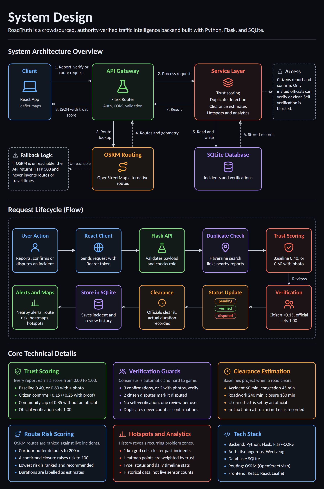
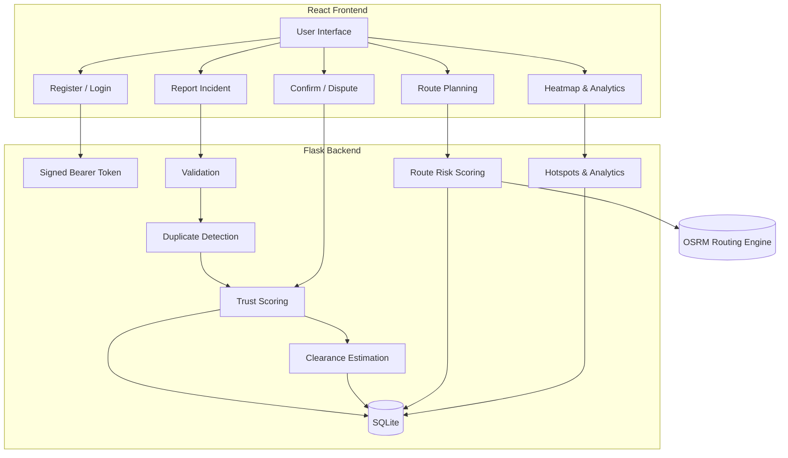

# RoadTruth

## Why I Built RoadTruth

Navigation apps like **Google Maps** and **Waze** are great at telling you *that* a road is slow. They rarely tell you *why*, whether the report is genuine, or whether the same junction has been failing for months.

The idea for RoadTruth came from a real problem: an employer who regularly needed to understand why employees were arriving late. "There was traffic" is hard to verify, and nobody had a way to separate a genuine accident from a vague excuse, or a one-off jam from a recurring bottleneck.

That led to a simple question:

> **Can traffic reports be verified instead of just trusted?**

RoadTruth is a crowdsourced, authority-verified traffic intelligence backend. Citizens report incidents, other citizens corroborate them, and authorised officials can confirm or dispute them. Every report carries a **trust score**, a **clearance-time estimate**, and a place in a **historical record** that can reveal recurring problem zones.

The core idea:

```text
REPORT  →  VERIFY  →  ALERT  →  ANALYSE
```

The application is built with Python, Flask, and SQLite, and was created for a 24-hour hackathon. It exposes a clean REST API designed to plug straight into a React frontend.

---

## Key Features

* **Crowdsourced incident reporting**: Report accidents, congestion, roadwork, hazards, weather disruption, closures, and more.
* **Trust scoring**: Every report gets a score from `0.00` to `1.00` that rises with corroboration and evidence.
* **Authority verification**: Authorised officials can verify, dispute, or clear incidents.
* **Community consensus**: Independent confirmations automatically promote a report to `verified`.
* **Duplicate detection**: Nearby reports of the same type are linked rather than double counted.
* **Clearance-time estimation**: Category-based baselines, plus actual vs. estimated duration tracking.
* **Alternative routes**: Real routes from OSRM, ranked by incident risk and closure avoidance.
* **Route alerts**: Incidents detected along any route corridor.
* **Heatmaps and hotspots**: Map-ready points and 1 km grid clusters of recurring problem zones.
* **Analytics**: Type distribution, status breakdown, and daily timelines.
* **Token-based auth**: Role-based registration and login.

---

## Project Structure

```text
RoadTruth/
├── backend/
│   ├── __init__.py                 # Package entrypoint & model exports
│   ├── app.py                      # Flask app factory, CORS, routes & error handling
│   ├── config.py                   # App configuration & CORS allowed origins
│   ├── models.py                   # Incident & IncidentVerification models
│   ├── validators.py               # Schema, type & coordinate validation
│   ├── proximity.py                # Haversine distance, duplicate check & nearby alerts
│   ├── verification_service.py     # Trust scoring, consensus & official verification
│   ├── clearance_service.py        # Baseline clearance duration & resolution lifecycle
│   ├── analytics_service.py        # Heatmap data, grid hotspots & analytics
│   ├── requirements.txt            # Backend dependencies
│   └── instance/
│       └── roadtruth.sqlite3       # Local SQLite database (ignored)
│
├── tests/
│   └── test_api.py                 # 32 automated unit & regression tests
│
├── docs/
│   └── system_architecture.png     # System design diagram used in this README
│
├── .env.example                    # Environment variable template
├── .gitignore
├── requirements.txt                # Root requirements
├── run.py                          # Self-bootstrapping launcher
├── run_server.bat                  # One-click Windows launcher
├── thunder-collection_roadtruth.json
├── RoadTruth_API.postman_collection.json
└── README.md
```

### Directory Overview

| Path | Purpose |
| ---- | ------- |
| `backend/` | The Flask API. Each concern (verification, clearance, proximity, analytics) lives in its own service module. |
| `tests/` | End-to-end API tests. External routing calls are mocked, so no internet is needed. |
| `docs/` | Documentation assets, including the system design diagram. |
| `run.py` | Creates a virtualenv, installs dependencies, and starts the server. |

---

## Architecture Overview

1. A user registers or logs in and receives a signed Bearer token.
2. They submit an incident with type, description, and coordinates.
3. The backend validates the payload, assigns a baseline **trust score** and **clearance estimate**, and checks for nearby duplicates.
4. Other users **confirm** or **dispute** the report. An authorised official can **verify**, **dispute**, or **clear** it.
5. Trust score and status update automatically from the verification rules.
6. Clients consume nearby incidents, route alerts, alternative routes, heatmaps, and hotspots.

---

## System Architecture



The diagram above shows how RoadTruth processes requests, scores trust, verifies incidents, and serves routes and analytics.

<details>
<summary><b>View as a Mermaid diagram</b></summary>



</details>

---

## Trust-Scoring System

All trust scores are normalised to **[0.00, 1.00]**.

### Scoring Rules

| Event | Effect |
| ----- | ------ |
| New report | Starts at **0.40** (or **0.60** with a photo/dashcam URL) |
| Official verification | Sets score to **1.00**, status `verified` |
| Citizen confirmation | **+0.15** each |
| Citizen confirmation with proof URL | **+0.25** each |
| Community cap (no official) | Maximum **0.85** |
| Official dispute | Sets score to **0.10**, status `disputed` |
| Citizen dispute | **−0.20** each |

**Authorised roles:** `police`, `traffic_police`, `traffic_authority`, `emergency_service`, `road_operator`

### Consensus Rules

* **3 independent confirmations**, or **2 confirmations with photo evidence**, moves an incident from `pending` to `verified`.
* **2 or more citizen disputes** moves it to `disputed`.

### Anti-Spam and Fraud Guards

* **Self-corroboration guard**: A reporter cannot verify their own report (`400 Bad Request`).
* **Duplicate review guard**: One review per user per incident (`409 Conflict`), enforced by a database unique constraint.
* **Duplicate proximity isolation**: Nearby reports of the same type are linked as potential duplicates and do not count as independent confirmations.

---

## Clearance-Time Estimation

When no clearance time is supplied, a baseline is applied by category.

| Category | Baseline | Typical scenario |
| -------- | -------- | ---------------- |
| `accident` | 60 min | Towing, debris sweep, lane reopening |
| `congestion` | 45 min | Rush-hour dispersal |
| `roadwork` | 240 min | Active repair or resurfacing window |
| `closure` | 180 min | Structural barricades, major diversions |
| `weather` / `weather_disruption` | 90 to 120 min | Waterlogging, storm runoff, low visibility |
| `hazard` / `road_hazard` | 30 to 90 min | Debris, fallen branches, spills |
| `roadblock` / `road_closure` | 120 min | Authority barricades, events, VIP diversions |
| `breakdown` / `vehicle_breakdown` | 40 min | Tyre change or flatbed tow |
| `other` | 60 min | General fallback |

### Estimated vs. Actual

| Field | Meaning |
| ----- | ------- |
| `estimated_clearance_time` | Projected time the road becomes clear |
| `cleared_at` | UTC timestamp when an official marks it resolved |
| `actual_duration_minutes` | Time between `created_at` and `cleared_at` |

---

## Getting Started

### Prerequisites

* Python **3.9+**
* pip

### Installation

```bash
git clone https://github.com/shreya15bhat/RoadTruth.git
cd RoadTruth
cp .env.example backend/.env
```

### Run the Server

```bash
python run.py
```

On Windows you can also double-click `run_server.bat`. Expected output:

```text
>> Starting RoadTruth Backend on http://127.0.0.1:5000
```

### Verify It Works

Open <http://127.0.0.1:5000/api/health>:

```json
{
  "database": "connected",
  "service": "RoadTruth Backend",
  "status": "healthy",
  "timestamp": "2026-10-23T14:40:00Z"
}
```

### Environment Variables

| Variable | Default | Description |
| -------- | ------- | ----------- |
| `PORT` | `5000` | Flask server port |
| `FLASK_DEBUG` | `True` | Debug mode and live reloader |
| `SECRET_KEY` | `roadtruth-hackathon-secret-key-2026` | Token signing key. **Override in production.** |
| `DATABASE_URL` | `sqlite:///backend/instance/roadtruth.sqlite3` | Database location |
| `CORS_ORIGINS` | `http://localhost:3000,http://localhost:5173` | Allowed frontend origins |
| `OFFICIAL_INVITE_CODE` | *(set on server)* | Required to register official accounts |
| `ROUTING_PROVIDER_URL` | `https://router.project-osrm.org` | Routing engine endpoint |

---

## API Reference

### General and Auth

| Method | Endpoint | Description |
| ------ | -------- | ----------- |
| `GET` | `/` | API status and endpoint directory |
| `GET` | `/api/health` | Health check and database connectivity |
| `POST` | `/api/auth/register` | Register a user (role verified server-side) |
| `POST` | `/api/auth/login` | Log in and receive a signed Bearer token |
| `GET` | `/api/auth/me` | Current user profile |

### Incidents

| Method | Endpoint | Description |
| ------ | -------- | ----------- |
| `GET` | `/api/incidents` | List incidents (`?status=`, `?type=`) |
| `POST` | `/api/incidents` | Create an incident (trust score and duplicate detection applied) |
| `GET` | `/api/incidents/<id>` | Full incident details |
| `POST` | `/api/incidents/<id>/verify` | Confirm, dispute, or add evidence |
| `POST` | `/api/incidents/<id>/clear` | Mark resolved (officials only) |
| `GET` | `/api/incidents/<id>/verifications` | Verification history |
| `GET` | `/api/incidents/<id>/duplicates` | Proximity duplicates (`?radius_km=0.5`) |
| `POST` | `/api/incidents/check-duplicates` | Pre-flight duplicate check |
| `GET` / `POST` | `/api/incidents/nearby` | Incidents near a location (`latitude`, `longitude`, `radius_km`) |

### Routing

| Method | Endpoint | Description |
| ------ | -------- | ----------- |
| `POST` | `/api/routes/alternatives` | Alternative routes ranked by incident risk and closure avoidance |
| `POST` | `/api/routes/alerts` | Incident alerts along a route corridor |

### Analytics

| Method | Endpoint | Description |
| ------ | -------- | ----------- |
| `GET` | `/api/incidents/heatmap` | Map-ready points (React Leaflet) |
| `GET` | `/api/incidents/hotspots` | 1 km grid clusters of historical incidents |
| `GET` | `/api/incidents/analytics` | Type distribution, status breakdown, daily timeline |
| `GET` | `/api/incidents/stats/summary` | Total and per-status counts |

### Example: Alternative Routes

**Request** `POST /api/routes/alternatives`

```json
{
  "origin": { "latitude": 12.9716, "longitude": 77.5946 },
  "destination": { "latitude": 12.9352, "longitude": 77.6245 },
  "corridor_buffer_meters": 200.0
}
```

**Response** (trimmed)

```json
{
  "total_routes_found": 2,
  "recommended_route_id": "route_2",
  "traffic_disclaimer": "Travel times are routing estimates based on road network speed limits. Road closures and incident risk scores reflect live RoadTruth community and authority reports.",
  "routes": [
    {
      "route_id": "route_2",
      "route_name": "Via Koramangala Link (Bypass)",
      "rank": 1,
      "is_recommended": true,
      "recommendation_reason": "Recommended: Optimal alternative avoiding road closures (Risk score: 1.25).",
      "distance_km": 6.2,
      "estimated_duration_minutes": 13,
      "duration_type": "routing_engine_estimate",
      "risk_score": 1.25,
      "has_confirmed_closure": false,
      "incident_count": 1,
      "geometry": { "type": "LineString", "coordinates": [[77.5946, 12.9716], [77.6245, 12.9352]] }
    },
    {
      "route_id": "route_1",
      "route_name": "Via Richmond Circle (Direct)",
      "rank": 2,
      "is_recommended": false,
      "recommendation_reason": "Discouraged: Verified road closure or roadblock detected directly along this corridor.",
      "risk_score": 100.0,
      "has_confirmed_closure": true
    }
  ]
}
```

---

## React Frontend Integration

CORS is preconfigured for Vite (`http://localhost:5173`) and Create React App (`http://localhost:3000`).

```javascript
const API_BASE = "http://127.0.0.1:5000/api";

function getAuthHeaders() {
  const token = localStorage.getItem("roadtruth_token");
  return token ? { Authorization: `Bearer ${token}` } : {};
}
```

<details>
<summary><b>Register and log in</b></summary>

```javascript
async function loginUser(usernameOrEmail, password) {
  const res = await fetch(`${API_BASE}/auth/login`, {
    method: "POST",
    headers: { "Content-Type": "application/json" },
    body: JSON.stringify({ username: usernameOrEmail, password }),
  });
  const data = await res.json();
  if (!res.ok) throw new Error(data.message || data.error);

  localStorage.setItem("roadtruth_token", data.token);
  return data.user; // { id, username, email, role, agency, ... }
}
```

Registration is the same shape against `/auth/register`, with `username`, `email`, `password`, `role`, and (for officials only) `official_key`.

</details>

<details>
<summary><b>Report an incident</b></summary>

```javascript
async function reportIncident({ type, description, locationName, latitude, longitude }) {
  const res = await fetch(`${API_BASE}/incidents`, {
    method: "POST",
    headers: { "Content-Type": "application/json", ...getAuthHeaders() },
    body: JSON.stringify({
      incident_type: type, // "accident", "congestion", "roadblock", ...
      description,
      location_name: locationName,
      latitude,
      longitude,
    }),
  });
  const data = await res.json();
  if (!res.ok) throw new Error(data.message || data.error);
  return data; // id, trust_score, estimated_clearance_time, possible_duplicates
}
```

</details>

<details>
<summary><b>Confirm, dispute, or add evidence</b></summary>

```javascript
async function submitVerification(incidentId, { action = "confirm", notes, evidenceUrl }) {
  const res = await fetch(`${API_BASE}/incidents/${incidentId}/verify`, {
    method: "POST",
    headers: { "Content-Type": "application/json", ...getAuthHeaders() },
    body: JSON.stringify({
      action, // "confirm" | "dispute" | "clear"
      supporting_info: notes,
      evidence_url: evidenceUrl || null,
    }),
  });
  const result = await res.json();
  if (!res.ok) throw new Error(result.message || result.error);
  return result; // { message, rationale, incident, verification }
}
```

</details>

<details>
<summary><b>Nearby alerts</b></summary>

```javascript
async function getNearbyAlerts(latitude, longitude, radiusKm = 5) {
  const res = await fetch(
    `${API_BASE}/incidents/nearby?latitude=${latitude}&longitude=${longitude}&radius_km=${radiusKm}`
  );
  if (!res.ok) throw new Error("Failed to fetch nearby alerts");
  return (await res.json()).incidents; // closest first
}
```

</details>

<details>
<summary><b>Heatmap points (React Leaflet)</b></summary>

```javascript
async function loadHeatmapData() {
  const res = await fetch(`${API_BASE}/incidents/heatmap`);
  const data = await res.json();
  return data.points.map((p) => [p.latitude, p.longitude, p.trust_score]);
}
```

</details>

<details>
<summary><b>Alternative routes and route alerts</b></summary>

```javascript
async function getAlternativeRoutes(origin, dest, bufferMeters = 200) {
  const res = await fetch(`${API_BASE}/routes/alternatives`, {
    method: "POST",
    headers: { "Content-Type": "application/json" },
    body: JSON.stringify({
      origin: { latitude: origin.lat, longitude: origin.lon },
      destination: { latitude: dest.lat, longitude: dest.lon },
      corridor_buffer_meters: bufferMeters,
    }),
  });
  const data = await res.json();
  if (!res.ok) throw new Error(data.message || data.error);
  return data.routes; // routes[0] is the recommended route
}

async function getRouteAlerts(routeCoordinates, bufferMeters = 250) {
  const res = await fetch(`${API_BASE}/routes/alerts`, {
    method: "POST",
    headers: { "Content-Type": "application/json" },
    body: JSON.stringify({ route_coordinates: routeCoordinates, buffer_meters: bufferMeters }), // [[lon, lat], ...]
  });
  const data = await res.json();
  if (!res.ok) throw new Error(data.message || data.error);
  return data.alerts;
}
```

</details>

---

## Testing the API

### Automated Tests

```bash
python -m unittest tests/test_api.py
```

```text
Ran 32 tests in 2.798s

OK
```

All tests run without internet access. External routing calls are mocked with `unittest.mock.patch`.

### Thunder Client (VS Code)

1. Install the **Thunder Client** extension.
2. Go to **Collections → ⋯ → Import** and choose `thunder-collection_roadtruth.json`.
3. Run any of the 17 pre-configured requests, covering auth, incidents, verification, clearance, hotspots, analytics, routes, and alerts.

### Postman

Import `RoadTruth_API.postman_collection.json` via **File → Import**.

---

## Security and Access Control

* Passwords are hashed with `werkzeug.security`.
* Tokens are signed, URL-safe serialized tokens (`itsdangerous`).
* Official registration (`traffic_police`, `transport_authority`, `admin`) requires a server-side `OFFICIAL_INVITE_CODE`.
* Incident clearance and official verification require an authenticated official account.
* Self-verification is blocked, and duplicate reviews are rejected at the database level.
* Change `SECRET_KEY` before any real deployment.

---

## Tech Stack

### Backend

* **Python and Flask**: REST API and routing.
* **Flask-CORS**: Cross-origin support for React dev servers.
* **SQLite**: Lightweight local storage.
* **itsdangerous and Werkzeug**: Token signing and password hashing.
* **OSRM (OpenStreetMap)**: Alternative route generation.

### Frontend (Integration Target)

* **React** with **Vite**.
* **React Leaflet**: Heatmaps and incident maps.

---

## Known Limitations

1. **Routing estimates are not live traffic.** `estimated_duration_minutes` comes from road network speed limits and is labelled `duration_type: "routing_engine_estimate"`. The `risk_score` and closure flags reflect RoadTruth community and authority reports.
2. **External routing dependency.** The default is the public OSRM server. If it is unreachable, the API returns **HTTP 503** rather than inventing routes. For production, point `ROUTING_PROVIDER_URL` at a self-hosted OSRM container.
3. **Hotspots are historical.** They group reports into 1 km grid cells to find recurring problem zones. They are not live sensor counts.
4. **SQLite is for development.** Move to PostgreSQL with PostGIS for production-scale geospatial queries.

---

## Roadmap

Ideas from the original problem statement that are not yet built:

- [ ] **Employer dashboard**: Employee journey status and delay verification. Deferred until explicit employee consent and organisational role-based access are properly modelled.
- [ ] **GPS speed verification**: Confirm congestion using speed and duration data, not just reports.
- [ ] **AI incident classification**: Photo-based hints for accidents, flooding, landslides, and fallen trees, always subject to verification.
- [ ] **Traffic prediction**: Forecast congestion windows from historical data.
- [ ] **Monthly reports**: Auto-generated statistics by cause, location, and delay hours.
- [ ] **Push notifications**: Alerts for affected routes.

---

## Learning and Inspiration

This project started from a real employer pain point: verifying why people are late, and understanding which roads fail repeatedly. The original problem statement ("RoadAlert / TrafficSense") was drafted with ChatGPT from that input, and RoadTruth is a focused, working slice of it:

```text
Incident → Data → Evidence → Analysis → Infrastructure Decision
```

Traffic engineering decisions always remain with the competent authority. RoadTruth only supplies the evidence.

---

## Author

Built by [Shreya Bhat](https://github.com/shreya15bhat) as part of a 24-hour hackathon.
